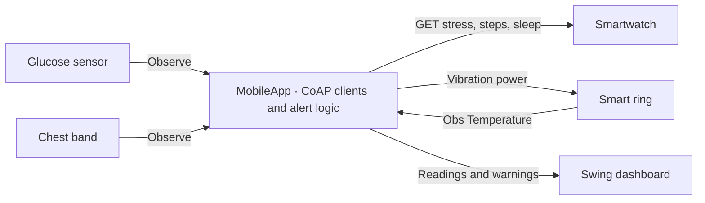

# IoT Health Monitoring System

A Java simulation of four wearable health devices communicating over CoAP, with a Swing dashboard for sensor readings, warnings, and smart-ring vibration feedback. All devices run locally; no physical hardware is required.

The project demonstrates CoAP Observe subscriptions, periodic GET requests, asynchronous POST commands, configurable alert thresholds, and an accelerated daily cycle.

## Architecture

[`StartEverything`](src/StartEverything.java) launches the four device servers and the desktop application in one JVM. Each device exposes CoAP resources over UDP. `MobileApp` coordinates the clients, evaluates readings, and updates the dashboard.



The ports shown are the defaults in [`appConfig.json`](appConfig.json).

| Device | Resource | Access pattern |
| --- | --- | --- |
| Glucose sensor | `/glucose-level` | Observe |
| Chest band | `/heart-rate` | Observe |
| Smart ring | `/skin-temperature` | Observe |
| Smart ring | `/ring-vibration` | Asynchronous POST with a JSON payload |
| Smartwatch | `/stress-level`, `/steps-count` | GET every ten simulated minutes |
| Smartwatch | `/sleep-quality` | GET at approximately 08:00 each simulated day |

Glucose, heart rate, and skin temperature each contribute one active warning when their reading falls outside the configured range. The requested vibration power is:

```text
power = min(number of active critical warnings, configured maximum power)
```

For example, two active critical warnings request power `2` with the default maximum of `3`. A successful POST response confirms the command before the dashboard updates the ring status. Stress warnings and the step goal are displayed separately and do not contribute to vibration power.

## Run locally

### Requirements

- A JDK with `java` and `javac` available. Compilation has been verified with **Java 23.0.2**; other versions have not been verified.
- A graphical desktop environment for Swing.
- UDP ports **5683–5686** available for the default configuration.

The required JARs are included in [`libs/`](libs/), and Californium sources are included in [`californium-core/`](californium-core/). No dependency download is needed to compile this checkout.

### Eclipse

1. Clone or download the repository.
2. Select **File → Import → General → Existing Projects into Workspace** and choose the repository root containing `.project` and `.classpath`.
3. Import the root project and select the installed JDK under **Project → Properties → Java Build Path → Libraries → JRE System Library**.
4. Allow Eclipse to build the project.
5. Run [`src/StartEverything.java`](src/StartEverything.java) using **Run As → Java Application**.

The working directory must be the **repository root**, where `appConfig.json` and `Californium.properties` are located. If needed, set it in **Run Configurations → Java Application → Arguments → Working directory**.

### Windows PowerShell

Run the following steps in the **same PowerShell window**. Variables and changes to `PATH` made here last only for that terminal session.

**1. Open the repository folder.** Replace the example path with the location of your checkout:

```powershell
cd "C:\path\to\IoT-Project"
```

This must be the folder containing `src`, `californium-core`, `libs`, and `appConfig.json`.
**3. Compile and launch.** Copy this whole block into the same terminal:

```powershell
$sources = @(Get-ChildItem src,californium-core -Recurse -Filter *.java |
    ForEach-Object { $_.FullName })
javac -encoding UTF-8 -cp "libs/*" -d bin $sources
if ($LASTEXITCODE -eq 0) {
    java -cp "bin;libs/*" StartEverything

Recompile after changing Java sources. Configuration-only changes require a restart. If you open a new PowerShell window, repeat steps 1 and 2 before launching again.
